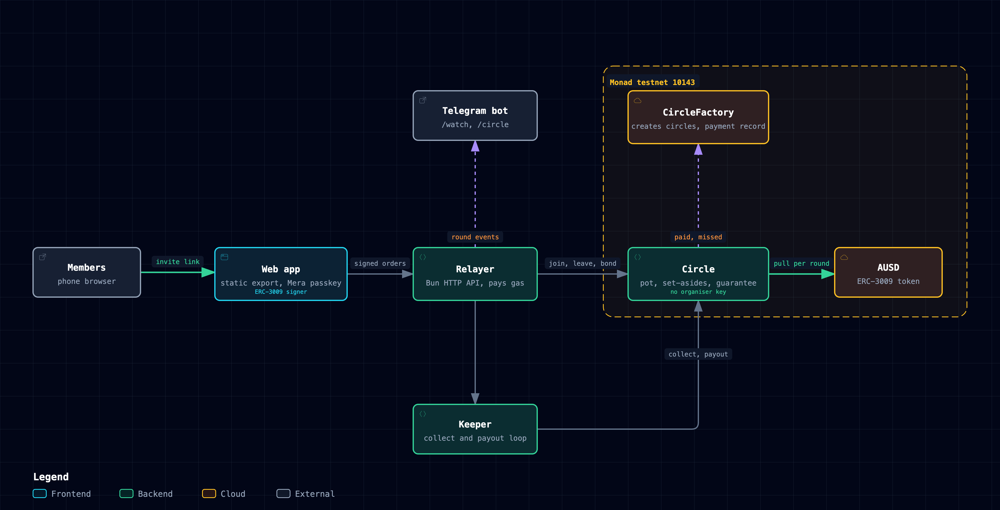

# grouppot

A savings circle (ajo, tanda, paluwagan) where the pot sits in a contract, not with the organiser. Everyone sees who has paid, and every round pays itself on its day.

Live: https://grouppot.vercel.app (Monad testnet, chain 10143)

## The 90-second loop

1. The organiser opens `/new`, names the circle, lists her people in the order they collect, and sets the amount and the period. She posts a guarantee that covers a missed round.
2. She sends one invite link to the group chat. Each member opens it on their phone and joins with the lock they already use to open the phone (a Mera passkey). No seed phrase, no app, no gas.
3. Joining signs one set of authorizations: round 0, a one-round set-aside, and a standing order for every later round.
4. A keeper pulls each round's standing orders when it opens and pays the pot to the member whose turn it is. Members see paid and unpaid live on the circle page, and a Telegram bot posts each round into the group chat.
5. After the last round every set-aside comes back, debts settled first, and the organiser gets back what is left of her guarantee.

## Architecture

[](docs/architecture.html)

Interactive version: [docs/architecture.html](docs/architecture.html).

## How it works

### Contracts (Monad testnet, chain 10143)

| Contract | Address | Role |
|---|---|---|
| CircleFactory | `0xb7a5618c080d7702ad81cdd1d257c2e14065f0d2` | Creates circles, keeps every member's payment record |
| AUSD | `0xa9012a055bd4e0eDfF8Ce09f960291C09D5322dC` | The dollar token each round is paid in (ERC-3009) |
| TabFactory | `0x540bdb9e0f89bf61722b9a7acfb321d68eb571ea` | Shared dinner tab: fixed shares, each member pays the host |

Addresses come from `deployments/`. The factory has created 28 circles.

- **Circle** holds the pot. The payout order is fixed when the circle starts. A member pays with an ERC-3009 `receiveWithAuthorization` signature, so members hold only AUSD and anyone may submit the pull.
- **Missed round.** The member's own set-aside covers it, then the organiser's guarantee, so the collector is paid in full. Anything left is recorded as the defaulter's debt and repaid from their own payout when their turn comes. Skipping rounds before your turn never pays.
- **Payment record.** The factory counts rounds paid, missed and finished clean per address. An organiser can keep early slots for members with a clean record, so a newcomer cannot take the first place.
- **Leaving.** Until the circle fills, a member leaves with a signed request and gets back everything they put in; the place reopens.

### Off-chain

- `relayer/`: a Bun HTTP server that submits signed create, join, contribute, leave and bond calls and pays the gas. It also runs the keeper (collect, payout, set-aside return, guarantee return) and renders the share card for link previews. `GET /api/health` reports the factory, circle count and reserves.
- `relayer/telegram.ts`: a long-polling Telegram bot. `/watch <circle link>` follows a circle, `/circle` shows where it stands, `/stop` unfollows. Each chain event becomes one short message.
- `web/`: a Next.js static export. Passkey sign-in derives the signing key in the browser from the WebAuthn PRF output and keeps nothing in storage.

## Proof

| Claim | How to check |
|---|---|
| Contracts pass 29 tests (26 circle, 3 tab) including a fuzz over any default pattern | `cd contracts && forge test --fork-url https://testnet-rpc.monad.xyz` |
| 8 deliberately broken versions of the circle each fail the suite | `contracts/results-mutants.txt` (one section per mutant) |
| Relayer logic passes 50 tests | `cd relayer && bun test` |
| The factory is deployed and live | `cast receipt 0x048682c0a3f9bca0964c64db3b6246c2afa7ed91592e44116ea567f0c2f7bee5 --rpc-url https://testnet-rpc.monad.xyz` (status 1, block 67552995) |
| A public passkey join settles on chain | tx `0x58cbd1bfca73862e7d94b79e3dfa6a211b7dedf29ecfe8b5668ea2383b79150f`, status 1 |
| The keeper pays the pot to the member whose turn it is | tx `0x90e8f6f37be5c9af611dd9cf4d14a5e53ae65c4a1fd460985bc57d1e3d2ec382`, `PaidOut` 6 AUSD, status 1 |
| A proven member takes a kept first place, a newcomer is refused it | join tx `0x899f258851beabc7455f1008009802266c26e685657f8a9f187f4a17728bf54b`; the refusal is asserted in `demo/e2e-record.ts` |
| A leave refunds and reopens the place | tx `0x598b1402a71a2e2fcd777aa1193ddb9d8763c38f5dd1e0f5721de7df963e528d`, status 1 |
| A finished circle leaves every member with a clean record | `cast call 0xb7a5618c080d7702ad81cdd1d257c2e14065f0d2 "recordOf(address)((uint64,uint64,uint64,uint64))" 0xFe10263C5b04Bf7D759b5423bE7EBaC1D6136C7d --rpc-url https://testnet-rpc.monad.xyz` returns paid 3, missed 0, finished 0, finishedClean 1 |
| A seeded circle runs round by round | `bun run demo/check-circle.ts record 0xc4ae9c3734800075c13a7b850ddf771dcce9c0ce 3` (circle page `/c/?id=0xc4ae9c3734800075c13a7b850ddf771dcce9c0ce`) |
| The live site and its relayer are up | `curl https://grouppot.vercel.app/api/health` returns `ok: true` with the keeper running and Telegram connected |


## Run locally

```sh
bun install
cd contracts && forge test --fork-url https://testnet-rpc.monad.xyz
cd ../relayer && bun test
cd ../web && bun install && bun run dev      # http://localhost:3410
```

The relayer reads its RPC, port and keeper settings from environment variables (`MONAD_TESTNET_RPC_URL`, `PORT`, `KEEPER_MS`, `KEEPER_OFF`, `ALLOWED_ORIGINS`, `TELEGRAM_BOT_TOKEN`). `scripts/build-static.sh` builds the static site.

## Layout

```
contracts/   Circle, CircleFactory, Tab, TabFactory, tests, mutant results
relayer/     HTTP API, keeper, Telegram bot, share card
web/         Next.js app: landing, /new, /c (circle), /tab
deployments/ testnet addresses
demo/        end-to-end runs against testnet
docs/        public architecture diagram
brand/       logo and mark
```
